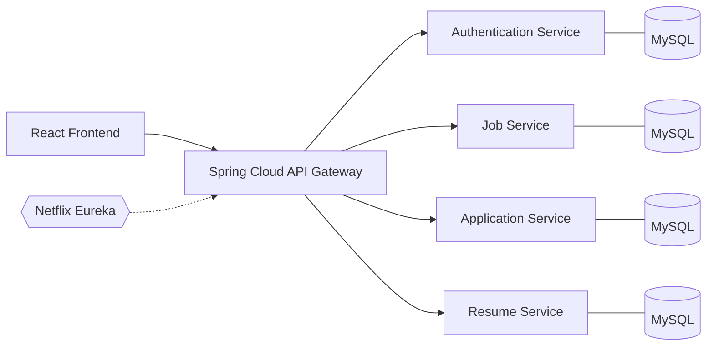

 

---

## About Me

I'm a **B.Tech CSE (Data Science)** graduate (2026) who builds backend systems with **Java, Spring Boot and Microservices**. I like designing clean REST APIs, securing them with **Spring Security, JWT and role-based access control**, and splitting systems into independent services with a **database-per-service** approach.

- Built a **microservices recruitment platform (HireSense)** with four independent services, Eureka discovery and a Spring Cloud API Gateway
- Built a **JWT-secured online voting system** and an **e-commerce app with Razorpay payments**
- Solved **200+ DSA problems on LeetCode** and hold a **4-star rating on HackerRank**
- **Goal:** a Java developer role where I can build scalable, secure and maintainable web applications

---

## Technical Skills

**Languages**

**Core Java & J2EE:** OOP · Collections · Multithreading · Java 8 (Streams, Lambdas) · Servlet · JSP · JDBC

**Backend Frameworks**

**Microservices**

**APIs & Security**

**Databases**

**Frontend (for full-stack work)**

**Tools & Platforms**

-326CE5?style=for-the-badge&logo=kubernetes&logoColor=white)

**Development Environment**

**Core Concepts:** Data Structures & Algorithms · MVC Architecture · Design Patterns · Debugging · Technical Documentation

---

## Featured Projects

### HireSense: Microservices-Based Recruitment Platform

> A job portal built as four independent Spring Boot services behind a Spring Cloud API Gateway, with Eureka service discovery, JWT security and ATS-style resume analysis.

**Architecture**

**Key features**

- **Microservices architecture:** four independent services (Authentication, Job, Application, Resume) with Netflix Eureka service discovery and a Spring Cloud API Gateway
- **Security:** JWT authentication and Spring Security with role-based access control for three roles: Admin, Employer and Job Seeker
- **Resume management and ATS:** resume upload/download, text extraction, ATS-style resume analysis and skill-based job matching with score-freshness tracking and fallback scoring
- **Job and application management:** employers post jobs and shortlist or reject candidates; job seekers apply and track application status; admins manage the platform
- **Role-specific REST APIs and React dashboards** for each user role
- **Database-per-service** with MySQL, plus health-check scripts to monitor services and speed up troubleshooting

 

<table>
  <tr>
    <td width="50%" valign="top">

### Votezy: Online Voting Application

A secure voting system with JWT authentication and role-based authorization, built on a layered MVC architecture.

- RESTful APIs with Spring MVC, Spring Data JPA and MySQL
- React frontend with vote counting and result visualization showing the winner and totals
- All APIs documented and tested with Swagger/OpenAPI

</td>
    <td width="50%" valign="top">

### GadgetHub: E-Commerce Web Application

A full-stack electronics store with role-based access for Guest, Customer and Admin, and online payments through Razorpay.

- Guests browse products; customers manage the cart and use a "Buy Now" checkout with Razorpay
- Admin dashboard for products, stock and orders (CRUD)
- Input validation and error handling for reliability

</td>
  </tr>
</table>

---

## GitHub Statistics

---

## Developer Activity

> The snake animation needs the optional GitHub Action described in the setup notes. Delete the snake image above if you skip it.

---

## Currently Learning

Deepening containerization, orchestration and AI integration for Spring applications, and keeping up with DSA practice on LeetCode.

---

## Education

| Degree | Institution | Years | Score |
|---|---|---|---|
| **B.Tech, Computer Science and Engineering (Data Science)** | IES College of Technology, Bhopal (RGPV) | 2022 – 2026 | CGPA: 7.62 |
| Class XII, Science | Parasnath Inter College, Giridih | 2021 – 2022 | 82% |

**Certification:** Programming in Java, NPTEL (IIT Kharagpur), Jul–Oct 2024, Elite grade

**Achievements:** 200+ DSA problems solved on LeetCode · 4-star rating on HackerRank

---

## Connect With Me

  

*Open to Java Backend / Full Stack Developer opportunities. Feel free to reach out.*

